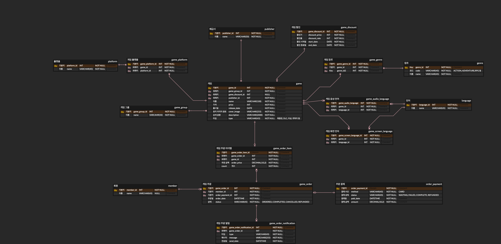
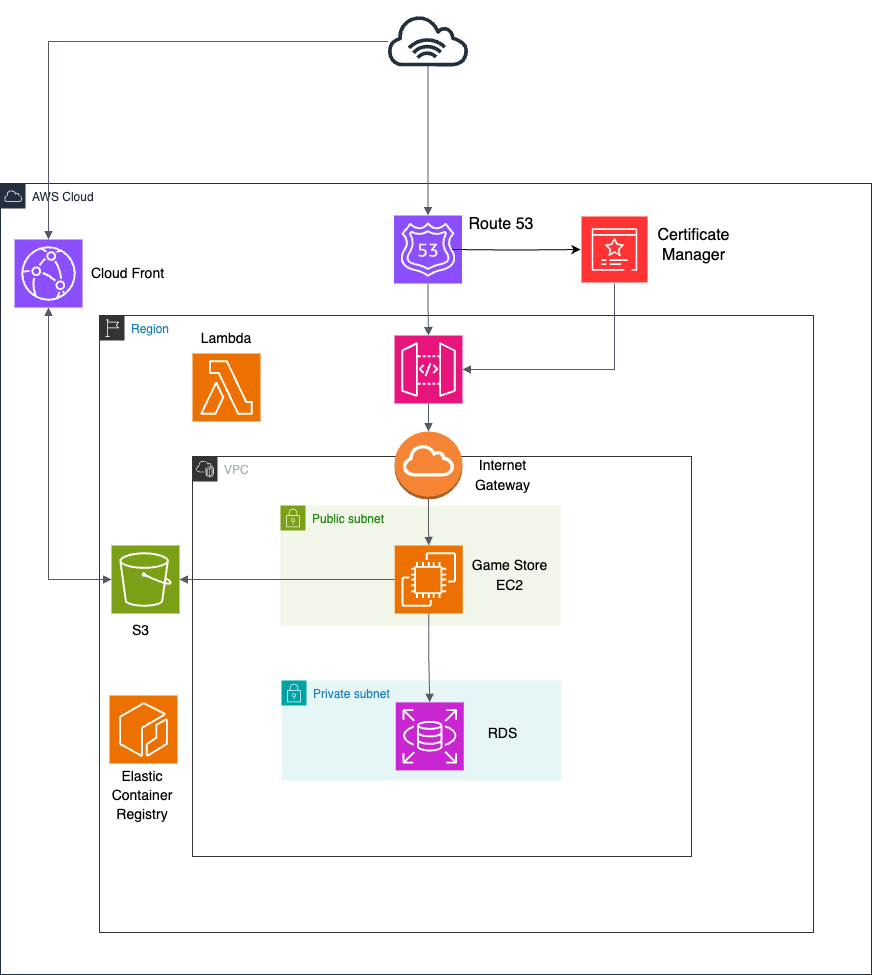

# Game-Store 핵심 요약
- 스파이크 테스트: Entity -> Projection DTO 방식의 성능 개선
- 레디스를 도입하기 전 고려할 트레이드오프
- HTTP 커넥션 타임아웃 설정이 필요한 이유

## 목차
- [기술 스택](#기술-스택)
- [테이블 ERD](#테이블-ERD)
- [프로젝트 개선 사항 기록](#프로젝트-개선-사항-기록)

## 기술 스택

### 백엔드
- Java 17
- SpringBoot 3.4.1
- JPA (Spring Data JPA, QueryDSL)
- MySql 8.0.32
- AWS

### 테스트 도구
- JMeter

## 테이블 ERD



## 프로젝트 개선 사항 기록

### 1. 테스트를 통한 성능 향상 기록
_JMeter를 사용한 스파이크 테스트_
- 조건: 동시 접속자 150명이 60초간 게임 할인 목록 조회 API 요청 (game 데이터 550개 대상)
- 컴퓨터 사양: 맥북 M2 프로, 램 16GB, CPU 8코어
- 변경 전: 엔티티 직접 조회
- 변경 후: Proejction DTO 생성자를 통한 조회
- 성능 차이 발생 원인
	- Game 엔티티의 모든 컬럼을 조회하면서 불필요한 데이터 전송 및 메모리 사용량 증가
 	- JPA는 조회한 엔티티를 영속성 컨텍스트에 저장하고 스냅샷 생성 → CPU 및 메모리 오버헤드 발생

#### 테스트 결과 테이블
|조회 방법|프로세스 CPU 사용량(%)|최소 지연 시간(ms)|최대 지연시간(ms)|초당 처리량(TPS)|전체 처리량|실패율|
|---|---|---|---|---|---|---|
|엔티티 조회 방식|28|6|1741|547 req/sec|33,000|0|
|Proejction DTO 생성자 방식|15|2|1500|1,229 req/sec|74,000|0|

#### 테스트 코드
```java
// 엔티티 직접 조회(BatchSize 옵션 사용)
public PageImpl<GamePromotionResponse> oldSearchPromotionGame() {
	return queryFactory
			.select(game)
			.from(game)
			.join(game.gameDiscount, gameDiscount).fetchJoin()
			.where(
				genreCondition(condition.getGenreIds()),
				platformCondition(condition.getPlatformIds()),
				gameTypesIn(condition.getTypes()),
				gameDiscountPriceCondition(condition.getWebBasePrices()))
			.fetch();
}

// Proejction DTO 생성자 사용
public PageImpl<GamePromotionResponse> improvedSearchPromotionGame() {
	return queryFactory
			.select(Projections.constructor(ImprovedGamePromotionResponse.class,
				game.id, game.name, game.price, game.coverImage, ...))
			.from(game)
			...
}
```

### 2. 레디스 캐시 적용
__레디스 사용 이유 & 트레이드오프__
- 게임 등록 화면을 진입시마다 @ModelAttribute 애노테이션을 통해 게임그룹, 장르 등 데이터 쿼리가 매번 발생
	- 레디스 서버에 해당 데이터를 캐시로 등록하고 조회하여 사용
- DB는 디스크 기반 I/O, Redis는 메모리 기반 I/O 속도 차이가 10배 정도 발생
- 장점: DB 커넥션 풀 기본 개수는 10개인데, 트랙피 많이 발생하는 시점에 변경 가능성이 없는 데이터를 자주 조회하면 DB 부하 발생 가능성이 높다
- 단점: 레디스 서버 추가로 운영 복잡도 증가
- 트레이드오프: 레디스 캐시보다는 스프링 캐시를 사용하는 게 소규모 서비스인 경우 적합할 것으로 판단하며, 실습을 위한 레디스 선택
- 캐시 고려 대상: 조회가 빈번하며 데이터 용량이 작고, 변경 가능성이 적은 경우
```java
//기존 방식
@Controller
GameController {
  ...
  @ModelAttribute("genres")
  public List<GenreResponse> genres() {...}
}

//레디스 매니저 클래스 사용
@Controller
GameController {
  private final RedisCacheManager redisCacheManager;

  @ModelAttribute("gameGroups")
  public List<GameGroupResponse> gameGroups() {
      return redisCacheManager.getCacheGameGroups();
  }
}

@RequiredArgsConstructor
@Component
public class RedisCacheManager {
	public List<GenreResponse> getCacheGenres() {
		final String KEY = "list:genres";
		String jsonData = stringRedisTemplate.opsForValue().get(KEY);
		
		if (jsonData != null) {
			return deserializeJson(jsonData, new TypeReference<ArrayList<GenreResponse>>() {
			});
		}
		
		List<GenreResponse> genreResponses = genreRepository.findAll().stream()
				.map(GenreResponse::new)
				.sorted(Comparator.comparing(GenreResponse::getName))
				.toList();
		
		stringRedisTemplate.opsForValue().set(KEY, serializeJson(genreResponses), 24, TimeUnit.HOURS);
		
		return genreResponses;
    }

	private <T> String serializeJson(T data) {
		return objectMapper.writeValueAsString(data);
    }

	private <T> T deserializeJson(String json, TypeReference<T> typeReference) {
		return objectMapper.readValue(json, typeReference);
    }
}
```

### 3. HTTP 통신 타임아웃 설정
__타임아웃 옵션__
- HTTP 통신 시 연결 시간이나 응답 대기 시간을 설정하지 않으면, 네트워크 지연이나 서버 응답이 없는 상황에서도 요청을 대기<br>
- 결국 쓰레드 풀에 쓰레드가 반납되지 않게 되어 서버가 다운되는 상황이 발생 가능
```java
@Bean
public RestTemplate restTemplate() {
  SimpleClientHttpRequestFactory httpRequestFactory = new SimpleClientHttpRequestFactory();
  httpRequestFactory.setConnectTimeout(3000); //(연결시) 서버와 연결(Connection) 시도 최대 대기 시간
  httpRequestFactory.setReadTimeout(5000); //(응답시) socketTimeout, 서버 응답 대기 시간
}
```

### 4. 쿼리 실행 계획, 인덱스 설정
```sql
#할인 중인 게임 목록 조회 쿼리
SELECT g.*
FROM game g JOIN game_discount gd 
	ON g.game_discount_id = gd.game_discount_id
```
__인덱스 설정 관련 학습사항__
- 게임 할인 외래키에 인덱스 설정 후 조인 데이터가 476 건에서 268 건으로 줄어듦 (조회 대상에서 NULL 값 제외 하기 때문)
- 인덱스가 없을 경우 전체 테이블 스캔이 발생하는 반면, 인덱스가 존재하면 필요한 데이터만 빠르게 조회
- 옵티마이저는 인덱스를 통해 더 효율적인 조인 순서를 선택한다
- 복합 인덱스는 왼쪽 순서부터 인덱스가 적용된다

### 5. AWS 환경 구성 (계정 만료 ERD만 유지)

